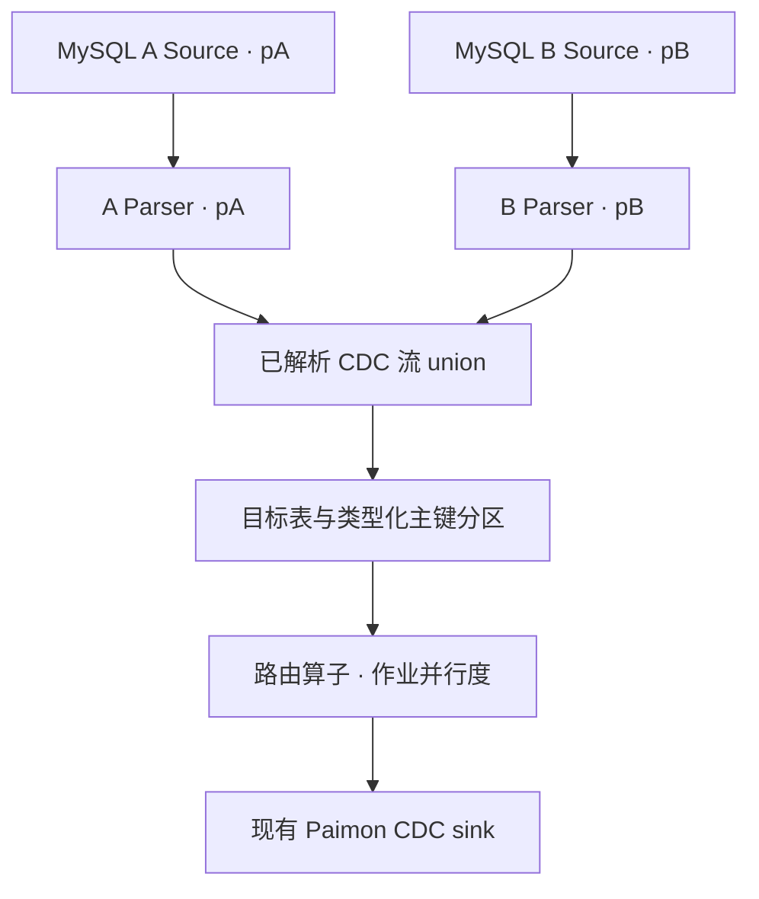

<!--
Licensed to the Apache Software Foundation (ASF) under one
or more contributor license agreements.  See the NOTICE file
distributed with this work for additional information
regarding copyright ownership.  The ASF licenses this file
to you under the Apache License, Version 2.0 (the
"License"); you may not use this file except in compliance
with the License.  You may obtain a copy of the License at

  http://www.apache.org/licenses/LICENSE-2.0

Unless required by applicable law or agreed to in writing,
software distributed under the License is distributed on an
"AS IS" BASIS, WITHOUT WARRANTIES OR CONDITIONS OF ANY
KIND, either express or implied.  See the License for the
specific language governing permissions and limitations
under the License.
-->

# MySQL 多实例接入 Paimon：PRD 与实现设计

- 日期：2026-10-19。
- 实现基线：Apache Paimon `release-1.3`，提交 `5c59e6cb01ed0b29563371f56e14fcade4597a2e`，项目版本 `1.3-SNAPSHOT`。
- 编译与验证依赖：该分支 CDC 模块声明的 Flink `1.20.1`、Flink CDC `3.1.1`。内部发行包或 CDC `3.6` 不属于本次已验证范围。
- 本地实现分支：`feature/mysql-multi-instance-cdc`。
- 对应验证结果：同目录 `mysql-multi-instance-validation.zh-CN.md`。本文件描述产品行为；实际执行结果以验证报告为准。

## 1. 背景和问题

当前 `mysql_sync_table` 与 `mysql_sync_database` 可以使用数据库名、表名的正则表达式选择分库分表，但是一组 `mysql_conf` 只产生一个连接配置和一个 MySQL CDC Source。正则表达式扩大的是同一实例内的匹配范围，无法表达不同主机、端口、凭据或独立 binlog 位点的多个实例。

用户希望一个 Flink 作业同时读取多个 MySQL 实例，把这些实例中的物理分表写入同一张或同一组 Paimon 逻辑表。各实例应能独立配置连接、时区、读取并行度和启动位点，并参加同一作业的 checkpoint。

源码依据（链接固定到实现基线）：

| 原有入口 | 行为及本次改动位置 |
| --- | --- |
| [SynchronizationActionBase](https://github.com/apache/paimon/blob/5c59e6cb01ed0b29563371f56e14fcade4597a2e/paimon-flink/paimon-flink-cdc/src/main/java/org/apache/paimon/flink/action/cdc/SynchronizationActionBase.java) | 原先统一创建一个 Source 和解析流；增加可覆盖的输入构建与源配置校验入口，保留旧路径。 |
| [MySqlSyncTableAction](https://github.com/apache/paimon/blob/5c59e6cb01ed0b29563371f56e14fcade4597a2e/paimon-flink/paimon-flink-cdc/src/main/java/org/apache/paimon/flink/action/cdc/mysql/MySqlSyncTableAction.java) | 原先从单一配置发现并合并 schema；增加逐实例发现、统一预检、独立 Source/Parser 与汇合。 |
| [MySqlSyncDatabaseAction](https://github.com/apache/paimon/blob/5c59e6cb01ed0b29563371f56e14fcade4597a2e/paimon-flink/paimon-flink-cdc/src/main/java/org/apache/paimon/flink/action/cdc/mysql/MySqlSyncDatabaseAction.java) | 原有分库分表逻辑依赖一个实例；增加按实例保留过滤条件、按最终目标表分组合并。 |
| [MySqlActionUtils](https://github.com/apache/paimon/blob/5c59e6cb01ed0b29563371f56e14fcade4597a2e/paimon-flink/paimon-flink-cdc/src/main/java/org/apache/paimon/flink/action/cdc/mysql/MySqlActionUtils.java) | 复用现有 JDBC schema 发现与 CDC Source 构建，不替换连接器。 |
| [MySqlRecordParser](https://github.com/apache/paimon/blob/5c59e6cb01ed0b29563371f56e14fcade4597a2e/paimon-flink/paimon-flink-cdc/src/main/java/org/apache/paimon/flink/action/cdc/mysql/MySqlRecordParser.java) | 每个实例使用自己的时区和元数据转换器；修正无主键表过滤使用完整数据库/表标识。 |
| [CDC 模块 POM](https://github.com/apache/paimon/blob/5c59e6cb01ed0b29563371f56e14fcade4597a2e/paimon-flink/paimon-flink-cdc/pom.xml) | 确定本次实际编译与测试的连接器版本。 |

## 2. 目标和验收标准

1. 一条 Action 命令可以声明两个及以上独立 MySQL 连接，单实例具名配置也具有明确行为。
2. 每个实例有独立的 Source、解析器、读取并行度、启动配置、时区以及可恢复的 Source 状态。
3. 默认保留不同实例、数据库和物理表中的同名主键数据；必须显式选择全局主键模式才能共用业务主键命名空间。
4. 所有实例完成 schema 发现和目标约束预检后，才创建或修改目标表；不兼容时明确给出实例或目标表信息。
5. 同一来源、同一目标主键的连续变更不因不同 Source 并行度而在新增汇合阶段乱序。
6. 表同步与整库同步复用现有 Paimon CDC sink、schema 演进和 checkpoint 提交机制。
7. 无具名配置时走原有单源路径；现有 Java `Map<String, String>` 构造方法和 Action 名称保持可用。
8. 通过单元测试、真实双实例增量测试和实际 savepoint 恢复测试验证上述行为。

## 3. 本期范围

| 能力 | 本期行为 |
| --- | --- |
| `mysql_sync_table` | 多实例、多库、多物理表汇入一张指定的 Paimon 表，支持现有计算列。 |
| `mysql_sync_database` | 多实例汇入同一 Paimon 数据库，要求 `merge_shards=true`，支持 `divided`、`combined`。 |
| 连接与读取配置 | 公共默认值与实例覆盖值；实例 hostname 必须显式声明。 |
| 表名转换 | 整库同步沿用 `table_mapping`、`table_prefix`、`table_suffix`。 |
| 主键 | 默认来源隔离；显式全局业务主键模式；要求存在实际业务主键。 |
| 动态新表 | `combined` 沿用现有动态发现能力，新建目标表自动应用来源字段与主键前缀。 |
| 旧单源命令 | 保持原路径与现有语义。 |
| 动态增删实例 | 不在本期范围；修改 Source 集合需要单独迁移验证。 |
| 跨实例事务一致快照或全局事件顺序 | 不提供；不同 MySQL 实例没有天然共同 binlog 顺序。 |
| 无业务主键表 | 不以三个来源字段充当整张表的唯一业务主键；无主键表沿用过滤/报错行为。 |
| 整库物理分表各自建表 | 具名模式不支持 `merge_shards=false`；通过显式表名映射定义逻辑目标。 |
| 整库计算列和数据库名前后缀 | 具名模式暂不支持 `computed_column`、`table_prefix_db`、`table_suffix_db`，启动时拒绝。 |

## 4. 配置协议

继续使用重复的 `--mysql_conf key=value` 参数，以 `source.<source-id>.<option>` 表达一个具名实例。

| 配置 | 规则 |
| --- | --- |
| `source.<id>.hostname` | 每个实例显式必填。`id` 只能含英文字母、数字、下划线、连字符；按 ID 排序构图。 |
| `source.<id>.port` | 覆盖公共端口，未设置时使用连接器默认端口。 |
| `username` / `password` | 可以作为公共默认值，也可以在各实例内覆盖；允许显式空密码。 |
| `database-name` | 支持公共正则和实例覆盖；表同步还需要 `table-name`。 |
| `source.<id>.server-id` | 每个实例最终配置必须有此项，可继承公共默认；推荐分别设置。单个整数或闭区间，如 `5400-5403`，范围必须容纳该实例的读取并行度。 |
| `scan.parallelism` | Action 层参数，支持公共默认和实例覆盖；默认使用作业并行度，未配置作业并行度时使用 1。该值设置 Source 算子并行度，各读取阶段的实际分工沿用 CDC 连接器。 |
| `server-time-zone` | 支持每个实例独立覆盖，交给相应实例的解析器。 |
| `scan.startup.mode` 等 | 支持公共默认和实例覆盖，复用现有连接器实现。 |
| `scan.startup.specific-offset.*` | 只能放在实例配置内，禁止多个实例继承一个公共 binlog 位点。 |
| `jdbc.properties.*` / `debezium.*` | 保持现有透传方式，并支持实例覆盖。 |
| `multi-source.key-mode` | 仅具名模式有效；`isolated` 为默认，`global` 需显式设置。 |

公共配置是默认值，实例配置覆盖同名默认值。CLI 中重复的同一个 `source.<id>.<option>` 键会报错，避免默默覆盖连接配置；具名模式也不允许混用 `--mysql_conf` 与旧拼写 `--mysql-conf`，但可以单独使用其中任一种。只要存在一个 `source.<id>.*` 就进入具名模式。公共 `hostname` 与具名配置混用会失败，避免旧连接被误当成可继承的第三个实例。没有具名配置时不会自动转换旧任务。

同一规范化 hostname/port 上的实例若使用重叠 `server-id` 范围，启动时拒绝；不同端点允许重复范围。该检查不解析 DNS 别名，也无法发现其他作业已占用的 ID。当前依赖的 CDC `ServerIdRange` 使用有符号 Java 整数，合法上界按 `2147483647` 校验。

数据库和表的正则表达式、正整数并行度、必填参数、嵌套具名配置及未知 `multi-source.*` 参数均有启动校验。配置校验错误不打印配置值。连接器的其他参数仍由现有 Source builder 校验。

### 4.1 多实例同步到一张表

```bash
flink run -p 2 /path/to/paimon-flink-action-1.3-SNAPSHOT.jar \
  mysql_sync_table \
  --warehouse hdfs:///warehouse/paimon \
  --database ods \
  --table orders \
  --mysql_conf username=cdc_reader \
  --mysql_conf "password=${MYSQL_CDC_PASSWORD}" \
  --mysql_conf 'database-name=trade_.*' \
  --mysql_conf 'table-name=orders_.*' \
  --mysql_conf server-time-zone=Asia/Shanghai \
  --mysql_conf source.shard_a.hostname=mysql-a.example.internal \
  --mysql_conf source.shard_a.port=3306 \
  --mysql_conf source.shard_a.server-id=5400-5403 \
  --mysql_conf source.shard_a.scan.parallelism=1 \
  --mysql_conf source.shard_b.hostname=mysql-b.example.internal \
  --mysql_conf source.shard_b.port=3306 \
  --mysql_conf source.shard_b.server-id=5500-5503 \
  --mysql_conf source.shard_b.scan.parallelism=2 \
  --table_conf bucket=2
```

这是默认隔离模式的示例。若业务主键为 `id`，目标主键为 `(source_id, database_name, table_name, id)`。各实例仍可以有各自的数据库/表名正则、凭据、时区。示例凭据通过环境变量替换，实际部署应采用现有凭据管理方式。

运行时需要使用包含本实现的 CDC 类以及项目匹配的 Paimon/Flink CDC 依赖；只复制入口 Action 小 JAR 不等于替换所有依赖。构建与部署说明见验证报告。

### 4.2 多实例整库同步

```bash
flink run -p 2 /path/to/paimon-flink-action-1.3-SNAPSHOT.jar \
  mysql_sync_database \
  --warehouse hdfs:///warehouse/paimon \
  --database ods \
  --mode combined \
  --merge_shards true \
  --including_tables 'orders|payments|invoices' \
  --mysql_conf username=cdc_reader \
  --mysql_conf "password=${MYSQL_CDC_PASSWORD}" \
  --mysql_conf 'database-name=trade_.*' \
  --mysql_conf server-time-zone=Asia/Shanghai \
  --mysql_conf source.shard_a.hostname=mysql-a.example.internal \
  --mysql_conf source.shard_a.server-id=5400-5403 \
  --mysql_conf source.shard_b.hostname=mysql-b.example.internal \
  --mysql_conf source.shard_b.server-id=5500-5503 \
  --table_conf bucket=2
```

整库模式不得设置 `mysql_conf table-name`；使用 Action 的 `including_tables` / `excluding_tables` 选择表。数据库过滤也按每个实例独立执行。同名 `db.table` 在实例 A 中被排除，不会误排实例 B 中的同名表。

## 5. 数据模型与主键语义

### 5.1 默认隔离模式

自动增加三个 `STRING NOT NULL` 元数据字段，并将其依次放在业务主键前面：

| 字段 | 值 | 稳定性要求 |
| --- | --- | --- |
| `source_id` | 配置中的逻辑实例 ID，如 `shard_a` | 保存于数据与算子 UID；不能为了调整配置顺序或更换主机名随意改名。 |
| `database_name` | 变更的物理 MySQL 数据库名 | 物理库改名属于来源身份变更。 |
| `table_name` | 变更的物理 MySQL 表名 | 物理表改名或跨分片搬迁需要定义数据迁移语义。 |

三个字段构成来源空间，业务主键区分该物理表内的行。实例 A 和实例 B 的 `orders(id=1)` 会保存为两条记录。主键更新沿用旧键删除、新键插入，两条事件都携带相同来源身份。

计算主键必须具有确定性，不能使用 `now()` 等会随处理时间变化的表达式生成业务身份；计算表达式本身的类型转换与拓宽约束沿用现有实现。

用户已有物理列或计算列与自动字段冲突时拒绝启动；运行期间 DDL/DML 中新出现的同名物理字段也会报错。大小写不敏感的 catalog 按相同规则检查，不允许以大小写变化绕过。

现有目标表必须具有完全一致的实际主键和分区键，且字段兼容；仅存在一个普通 `source_id` 列并不能隔离 `PRIMARY KEY(id)` 的冲突。不自动修改已有表主键，建议使用新目标表或进行明确的重建迁移。

### 5.2 全局模式

显式添加：

```bash
--mysql_conf multi-source.key-mode=global
```

该模式保留业务主键，不自动增加来源字段。用户可以显式选择元数据列。只有业务主键在所有参与的物理表之间全局唯一，或者用户明确要让它们表示同一条逻辑记录时才选择此模式。

同一个业务主键若被不同实例并发更新，系统不提供跨实例最后更新时间比较或全局事务顺序；结果受到达顺序和所选 Paimon merge engine 影响。实例删除事件也作用于相同业务主键。因此，实例之间仍使用各自自增 ID 的场景应保持默认隔离模式。

## 6. 数据流与状态设计



每个 Source 与对应 Parser 具有相同并行度，并使用 forward 边；不能在解析前统一并行度并引入 rebalance，否则同一来源的连续更新可能经过不同通道重新汇合而乱序。

union 后按最终目标表与实际目标主键分区，再经过一个实际存在的 map 算子承接统一并行度。该实体算子避免下游已有 forward 设置覆盖虚拟分区边。主键值先按目标字段类型转换，再生成稳定内容 hash，保证时间精度表示差异、数值字符串差异和二进制值不会使相同目标键被路由到不同通道。此阶段只用于分区，不用 hash 合并行，不引入 keyed state；hash 冲突只影响分区负载。

构图时未知的动态新目标表按完整目标表名路由；同一表在本次运行期间一直走相同分区，不在发现主键后中途改路由。这样保证新表内顺序，但该目标在此路由阶段最多利用一个并行分区。重启并完成启动发现后，已知目标可按主键分散。

解析器独立持有各自时区、过滤状态和来源元数据转换器。动态表 schema 构建器也应用相同隔离主键前缀。Source 使用公共基类已有的 watermark/idleness/alignment 构建方式。

| 算子 | 显式 UID |
| --- | --- |
| 实例 Source | `mysql-source-<id>` |
| 实例 Parser | `mysql-parser-<id>` |
| 多源路由 | `mysql-multi-source-route` |

具名实例按稳定 ID 排序构图，输入 Map 或 CLI 中的实例声明顺序不影响对应 Source 身份。

## 7. Schema、过滤和失败行为

启动分为发现、校验、建表/修改选项、构图几个阶段。表同步先发现全部实例，再按已有 JDBC schema 合并规则形成目标 schema。整库同步先按最终目标表名分组，再合并同一目标的所有实例分片。运行期间在解析 schema、行值和元数据前应用同一组库表过滤规则，并持续排除启动时已经拒绝的逻辑目标，防止新分片重新写入被排除的目标表。

类型兼容和 schema 演进复用 Paimon 原有规则；不声称任意类型差异都可合并。未显式指定目标主键时，源表之间推断主键不一致会在启动阶段暴露；显式 `primary_keys` 可以按原有规则覆盖推断结果，但指定字段必须存在。列名冲突、不兼容字段、目标真实主键或分区键不一致也会在启动阶段校验。`ignore_incompatible=true` 在具名整库模式中排除与已有 Paimon 目标不兼容的整个目标组，避免只写入部分分片；不同源之间的 schema 本身无法合并时仍直接失败，不通过该选项忽略。每个已声明实例在过滤后至少要保留一张可同步的主键表。

启动发现/约束预检失败不会先创建或修改部分目标表；通过预检后的实际 catalog 建表操作不是跨表事务，如果随后某次 catalog 写入失败，可能留下已创建的空表，需要按正常 catalog 运维方式处理。其他连接器参数也可能在 Source builder 中失败，不能将预检理解为对所有外部运行问题的事务保证。

`combined` 可以发现后续新增表。动态新表创建受本次的主键与元数据规则约束；动态新增分片映射到已有目标时，底层解析流程不重新对整组源表执行启动阶段主键合并。新增分片必须事先确认与该目标的业务主键和 schema 规则一致。本分支的 SchemaManager 禁止修改已有目标主键列的类型；本实现沿用该约束。普通非主键列的兼容拓宽不影响路由。在线修改业务主键、任意不兼容 DDL、跨分片迁移完整性均不在本期保证范围内。

## 8. Checkpoint、恢复与运维

一个作业中的所有 MySQL Source 参加同一 Flink checkpoint，每个 Source 保留自己的 snapshot/binlog 状态。Paimon 提交继续使用已有 checkpoint 机制。一个实例停顿、故障或恢复缓慢，会影响整个作业的 checkpoint 或吞吐，需要在容量和故障域上接受这一耦合。

本期真实 savepoint 验证覆盖表同步动作：相同 Source ID 集合、相同来源身份、相同主键模式，允许仅调整配置声明顺序。整库同步使用相同的稳定 Source UID 方案，但本次没有单独执行整库 savepoint 恢复用例。自动失败重启沿用同一个 JobGraph；从 aligned checkpoint/savepoint 重新提交可以安全地重新发现目标表。

不将以下情形声明为已验证的原地恢复：从旧单源任务直接切换到具名任务；增删或改名实例；变更来源物理身份；切换主键模式；snapshot 期间调整并行度；在重新构图、路由策略发生变化后手工从带旧通道状态的 unaligned checkpoint 恢复。需要这些能力时，应单独设计状态映射、数据迁移和恢复验收。

这不构成跨 MySQL 实例的同一事务快照，也不构成各实例事务的全局提交顺序。监控可通过 Source/Parser 名称中的实例 ID 区分各来源；现有连接器与 Flink 的吞吐、延迟、checkpoint 和异常指标继续使用。

## 9. 代码变更范围

| 文件或类 | 改动 |
| --- | --- |
| `MySqlSourceConfigs`（新增） | 具名参数分组、公共继承、稳定排序、并行度/server-id/模式校验。 |
| `MySqlMultiSourceSupport`（新增） | 来源元数据、主键模式、已有表约束检查、按类型化目标键路由。 |
| 两个 MySQL Action 与 Factory | 独立实例发现、独立读取/解析图、单源兼容、CLI 帮助。 |
| `SynchronizationActionBase` | 输入构建与配置校验扩展点；默认实现保持旧行为。 |
| `SyncDatabaseActionBase` | 动态新表 schema builder 扩展点。 |
| `CdcMetadataConverter` / `CdcMetadataProcessor` | MySQL `source_id` 元数据转换器。 |
| `MySqlRecordParser` | 元数据冲突检查、按数据库与表隔离无主键过滤。 |
| `NewTableSchemaBuilder` | 可选主键前缀与严格显式主键检查，默认值保持原行为。 |
| MySQL CDC 用户文档与本 PRD | 配置示例、语义和边界说明。 |

## 10. 验收计划与上线步骤

| 验收项 | 覆盖位置 |
| --- | --- |
| 配置继承、覆盖、合法/非法范围、旧配置、重复具名键 | `MySqlSourceConfigsTest` 及 Factory 配置测试。 |
| 跨实例 schema 合并、已有目标 PK 预检、单源图兼容 | `MySqlMultiSourceTableTest`。 |
| 来源元数据、前后镜像、独立时区、DDL/DML 列冲突 | `MySqlMultiSourceParserTest`。 |
| 整库分组、过滤隔离、table_mapping、whole-group 排除、新表主键 | `MySqlSyncDatabaseMultiSourceTest`。 |
| 相同目标键路由、类型规范化、二进制与动态新表稳定性 | `MySqlMultiSourceRoutingTest`。 |
| 真双实例全量、增删改、DDL、连续更新、主键更新 | `MySqlMultiSourceITCase` 表同步用例。 |
| 实际 savepoint、停机期间更新/删除、配置反序恢复 | `MySqlMultiSourceITCase` 恢复用例。 |
| 第二实例新增已有逻辑表分片、双方新增目标表 | `MySqlMultiSourceITCase` 整库 combined 用例。 |

建议先使用新目标库/表，在测试环境以两实例代表性分片验证数据量、PK、DDL 和恢复，再扩大到完整源集合。容量评估应包含连接数、MySQL snapshot 压力、每实例 server-id 范围、Flink 总 Source 并行度和最慢来源对 checkpoint 的影响。

上线前需要业务方确认：业务主键是否跨所有物理分片全局唯一；物理表如何映射逻辑目标；是否要求在线增删实例；实际内部 Paimon/Flink/CDC 发行包及已有任务状态迁移要求。这些问题影响模式选择和上线方案，不阻塞本期默认隔离实现。
